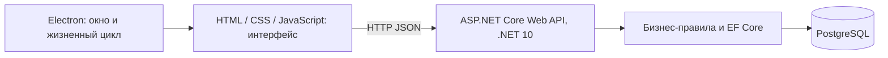

# Архитектура BaseDesk

Статус: архитектурная основа Issue #1. Документы задают предлагаемые договорённости; API и интерфейс подключения экранов требуют проверки владельцами до интеграции.

BaseDesk — десктопное приложение для управления рабочими данными малого бизнеса: организацией, доступными разделами, клиентами и задачами.

## Компоненты и ответственность

Electron и ASP.NET Core — независимые приложения с отдельными процессами, зависимостями и жизненными циклами. Electron.NET в новой архитектуре не используется.

| Компонент | Ответственность | Рабочая область |
| --- | --- | --- |
| Electron | Окно, загрузка оболочки, навигация, обработка недоступности API | `desktop/`, Александр |
| HTML/CSS/JS | Представление, события пользователя, mock-данные и позднее HTTP-запросы | `src/frontend/` |
| ASP.NET Core API | DTO, проверка входных данных, бизнес-правила, операции над данными | `src/backend/`, Андрей |
| EF Core | Отображение моделей в таблицы, запросы, миграции схемы | Внутри backend |
| PostgreSQL | Постоянное хранение и целостность связей | Отдельный сервис |

Frontend может проверять форму для удобства пользователя, но backend повторяет все проверки и определяет допустимость операции. Интерфейс не является источником истины о сохранённых данных. Mock-данные — только средство разработки экранов, без обещания сохранения после перезагрузки.

Frontend и Electron не подключаются к PostgreSQL напрямую: строка подключения и полномочия БД остаются у API, а единые бизнес-правила применяются при каждом запросе. Модели EF Core не передаются как публичные DTO автоматически.

## Запуск и размещение

Первая неделя: экраны просматриваются независимо в браузере через статический HTTP-сервер и используют mock-данные; backend разрабатывается отдельно и проверяется HTTP-запросами. Electron не нужен для проверки API, PostgreSQL не нужен для разработки экранов.

Следующий этап: PostgreSQL и API запускаются локально отдельными сервисами, затем через Docker Compose. Electron запускается отдельно на машине разработчика и получает адрес API из конфигурации. Порты, команды и управление процессом API согласуют Александр и Андрей; автоматический запуск API из Electron пока не определён. Compose и рабочие приложения в Issue #1 не создаются.

Позднее API и PostgreSQL размещаются на сервере, Electron остаётся клиентом. Изменяется настроенный базовый URL API; учётные данные БД по-прежнему не попадают в клиент. Доступный из сети сервер потребует отдельной задачи на HTTPS, аутентификацию и разграничение доступа до публикации. В нулевую версию эти функции, приглашения сотрудников, роли и удалённая синхронизация не входят. Локальный API предполагается доступным только на loopback-интерфейсе, БД — только backend.

Базовый URL не зашивается в каждый экран. Единый клиент запросов появится на этапе интеграции. При разных origin статического frontend и API Андрей согласует CORS для конкретных адресов разработки; отключение защиты браузера не является способом интеграции. Александр определит способ загрузки frontend в Electron и допустимый origin совместно с Андреем. Рекомендуемая граница оболочки: изоляция контекста, отсутствие Node.js в renderer, узкий preload API только при реальной необходимости.

## Переход от прототипа

Ветка `legacy/electron-net` хранит исходный прототип и не изменяется. На текущем этапе старые файлы также остаются в рабочей ветке:

- `src/backend/BaseDesk.App/`, `BaseDesk.sln`, `global.json` относятся к Electron.NET-прототипу;
- `src/frontend/index.html`, `styles.css`, `app.js` — стартовый экран прототипа;
- `docs/running.md` описывает только запуск прототипа.

Их наличие не означает готовность новой архитектуры. Новые страницы создаются в `pages/`, общие стили — в `styles/`, оболочка — в `desktop/`. Не подключайте старые `app.js` и `styles.css` к новым экранам автоматически. Старый `.csproj` копирует весь `src/frontend/**/*` при сборке; эта сборка не является проверкой новой архитектуры.

Андрей предложит отдельный API-проект `src/backend/BaseDesk.Api/` и согласует обновление решения с Ильёй. Александр создаст самостоятельный Electron-проект в `desktop/`. Замена старой точки входа frontend, исключение старого проекта из решения и возможное удаление его файлов выполняются отдельными проверяемыми изменениями после проверки замены. Автоматического переноса и удаления в Issue #1 нет.

Связанные документы: [разработка](development.md), [frontend](frontend-conventions.md), [контракты](api-contracts.md), [ветки команды](team-workflow.md).
